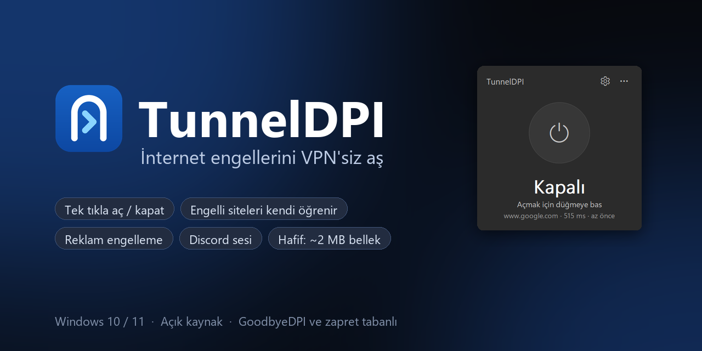
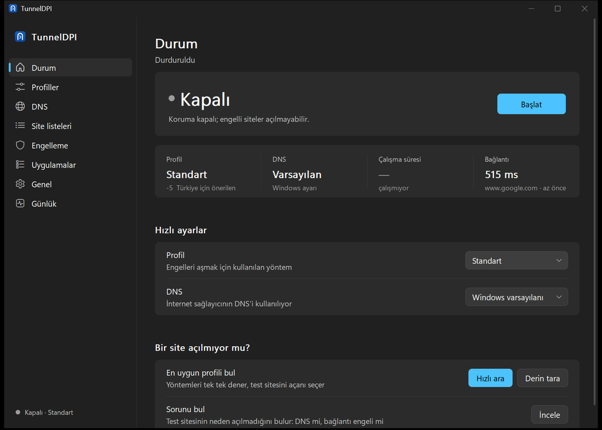

<p align="center"></p>

<p align="center">
  <a href="../../releases/latest"></a>
  <a href="LICENSE"></a>
  
</p>

**TunnelDPI**, internet sağlayıcıların "derin paket inceleme" (DPI) ile koyduğu site ve uygulama engellerini aşar. VPN değildir: trafiğin başka bir sunucuya gitmez, hızın düşmez. Bağlantıların bilgisayarında, engelleyen sistemin tanıyamayacağı biçimde gönderilir. Saatin yanındaki simgede sessizce çalışır ve tek tıkla açılıp kapanır.

## Kurulum

1. [Son sürüm](../../releases/latest) sayfasından **`TunnelDPI-Setup-x.y.z.exe`** dosyasını indir ve çalıştır.
2. **Kur**'a bas. İstersen Windows açılışında kendiliğinden başlamasını seç.
3. Saatin yanındaki simgeye sağ tıkla ve açma düğmesine bas.

Kurmadan kullanmak istersen `TunnelDPI-x.y.z-portable.zip` dosyasını bir klasöre aç ve `TunnelDPI.exe`'yi çalıştır. Klasör yolunda Türkçe karakter olmamalı.

Kaldırmak için: Windows Ayarlar → Uygulamalar → Yüklü uygulamalar → TunnelDPI → Kaldır. Kaldırınca koruma kapanır ve DNS ayarların eski haline döner.

Daha önce **Geçit** ya da **GoodbyeDPI Tray** kullandıysan kurulum ayarlarını ve listelerini taşır, eski sürümü de kaldırır.

## Kullanım

| | |
|---|---|
| **Simgeye sağ tık** | Hızlı panel: büyük düğmeyle korumayı aç/kapat, izlenen sitelerin durumu. ⋯ menüsünde son profiller, bağlantı testi, 30 dakika duraklatma, reklam engelleme. |
| **Simgeye tık** | Ayarlar penceresi. Açıklama gereken ayarların yanındaki ⓘ'ye tıkla. |
| **Simgeye orta tık** | Son kullandığın profiller arasında hızlı geçiş. |
| **Ctrl + Alt + G** | Korumayı her yerden aç/kapat. |
| **Kapatmak** | Panelde ⋯ → Çıkış, simgeye orta tık → Çıkış ya da Ayarlar → Genel → Kapat. |

<p align="center"></p>

### Bir site açılmıyorsa

- **Açılmasını sağla.** Durum sayfasındaki kutuya sitenin adresini yaz ya da tarayıcıdan yapıştır. TunnelDPI siteyi listene ekler ve dener; açılmazsa profilleri tek tek dener. Çalışan profil başkaysa yalnızca o site için bir *site kuralı* oluşturur, diğer siteler bugünkü profille devam eder.
- **İncele.** Aynı kutudaki site için engelin DNS'ten mi bağlantı engelinden mi geldiğini söyler.
- **En uygun profili bul.** Durum sayfasında *Hızlı ara* hazır profilleri dener. *Derin tara* 20 kadar yöntemi dener ve çalışanı yeni profil olarak kaydeder. Bulunan profil bağlı olduğun ağ için hatırlanır.
- **Engelli siteleri kendisi öğrensin.** Profiller sayfasından açılır. Bağlantısı kesilen siteler kendiliğinden bir listeye eklenir. Bir site ilk denemede öğrenilir, sayfayı yenileyince açılır.

### Özellikler

- **İki motor**
  - *Klasik*: hafif ve hızlı, çoğu engel için yeterli.
  - *Gelişmiş*: daha çok yöntem; Discord sesi ve zorlu engellerde daha güçlü.
- **Kendini onarır.** Koruma açıkken izlenen siteler 5 dakikada bir denetlenir; sonuç panelde görünür. Sağlayıcı yöntem değiştirip siteler açılmaz olursa TunnelDPI çalışan profili kendisi bulur ve geçer.
- **Site listeleri ve site kuralları.** Koruma yalnızca seçtiğin sitelere uygulanabilir; bir listedeki sitelere başka bir profil atanabilir (ör. Discord bir yöntemle, diğer siteler başka yöntemle). Listeler bir internet adresinden günlük güncellenebilir.
- **Ses ve oyunlar.** Discord sesli sohbet ve oyunlar için ek koruma.
- **DNS.** Yandex, Cloudflare, Google, Quad9, AdGuard, OpenDNS ya da kendi sunucun. İstersen şifreli DNS. En hızlı sunucuyu ölçer; seçili sunucu yanıt vermezse yedeğe geçer. Koruma kapanınca DNS eski haline döner.
- **Reklam engelleme.** HaGeZi, AdGuard ve StevenBlack listeleri, ayrıca kendi engel ve izin listen. Tüm programlarda geçerlidir.
- **Uygulamaya göre.** Koruma yalnızca seçtiğin programlara uygulanabilir ya da onları dışarıda bırakabilir.
- **Ağa göre profil.** Ev, iş, telefon gibi her ağ için ayrı profil.
- **Otomatik aç/kapat.** Seçtiğin bir program (ör. Discord) açılınca koruma açılır, kapanınca kapanır. İstersen belirli saatlerde (ör. gece) kendiliğinden kapanır.
- **Oyun modu.** Tam ekran bir oyun açılınca o oyunun bağlantısına dokunulmaz, ping etkilenmez; Discord sesi korunmaya devam eder.
- **Tarayıcı DNS denetimi.** Chrome, Edge, Brave, Opera ve Firefox'un kendi Güvenli DNS ayarını gösterir; DNS ayarının hangi tarayıcıda geçerli olduğunu bilirsin.
- **Yedekleme.** Profiller, listeler, kurallar ve ayarlar tek dosyaya yedeklenir, başka bilgisayarda geri yüklenir.
- **Kendini günceller.** Yeni sürüm çıkınca bildirir, tek tıkla kurar.
- **Hafif.** Boştayken yaklaşık 2 MB bellek. Arayüz Türkçe ve İngilizce.

## Antivirüs uyarıları

TunnelDPI ağ paketlerini değiştirmek için [WinDivert](https://github.com/basil00/WinDivert) sürücüsünü kullanır. Bu yüzden bazı antivirüsler onu yanlışlıkla zararlı gösterebilir. Kodun tamamı açıktır, sürücü imzalıdır. `WinDivert64.sys` açıklamasındaki Bitcoin adresi WinDivert geliştiricisinin bağış adresidir.

**Kaspersky** bu tür araçları engeller; devre dışı olsa bile kaldırılması gerekir.

## Derleme

| | |
|---|---|
| Gerekenler | [WinLibs MinGW-w64](https://winlibs.com/) (`winget install BrechtSanders.WinLibs.POSIX.UCRT`), Python 3 |
| Motor | `cd engine` → `mingw32-make CPREFIX= BIT64=1 WINDIVERTHEADERS=<WinDivert>\include WINDIVERTLIBS=<WinDivert>\x64` |
| Uygulama ve kurulum | `set WINDIVERT_DIR=<WinDivert>\x64` → `app\build.cmd <zapret klasörü>` |
| Çeviriler | `python -X utf8 app\i18n\gen.py` (eksik çevirileri de listeler) |

Çıktılar `app\pkg\` (taşınabilir paket) ve `app\TunnelDPI-Setup.exe`'dir. GitHub Actions her değişiklikte her şeyi kaynaktan derler; `v*` etiketi itildiğinde kurulumu ve taşınabilir paketi sürüm olarak yayınlar.

```
app/        TunnelDPI uygulaması (C, Win32)
  src/      tepsi, ayar penceresi, motor yönetimi, DNS, güncelleme…
  setup/    kurulum programı ve paketleyici
  i18n/     İngilizce çeviriler
  res/      simge, sürüm bilgisi, manifest
engine/     GoodbyeDPI tabanlı klasik motor
```

## Teşekkür ve lisans

TunnelDPI [Apache 2.0](LICENSE) lisanslıdır. Şu projelerin üzerine kuruludur; ayrıntılar [NOTICE](NOTICE) dosyasında:
- [GoodbyeDPI](https://github.com/ValdikSS/GoodbyeDPI): ValdikSS
- [GoodbyeDPI-Turkey](https://github.com/cagritaskn/GoodbyeDPI-Turkey): cagritaskn
- [zapret](https://github.com/bol-van/zapret): bol-van
- [WinDivert](https://github.com/basil00/WinDivert): basil00

GoodbyeDPI kodunun bütün geçmişi ve ona katkıda bulunanlar yukarıdaki depolarda durur; bu depo tek bir başlangıç anından başlar.

Bu yazılım yalnızca bağlantına yapılan haksız müdahaleleri aşmak içindir. Kullanımından doğan sorumluluk kullanıcıya aittir.
